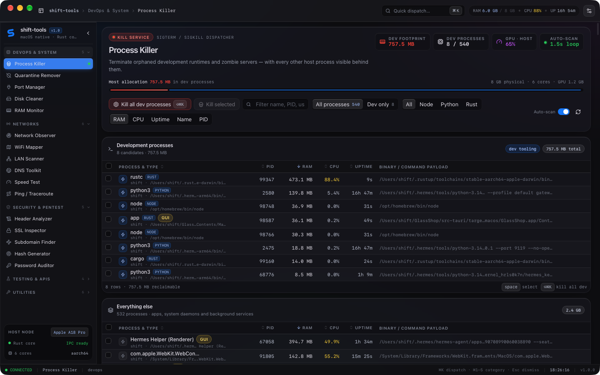
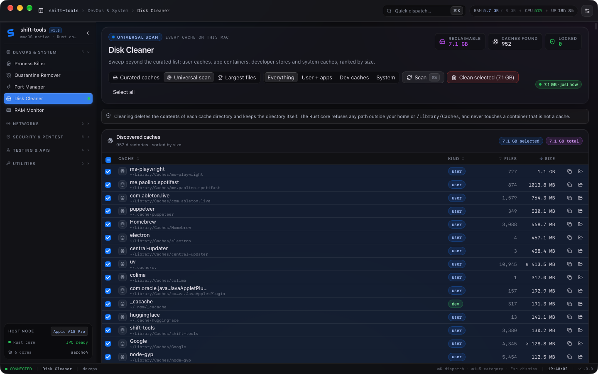
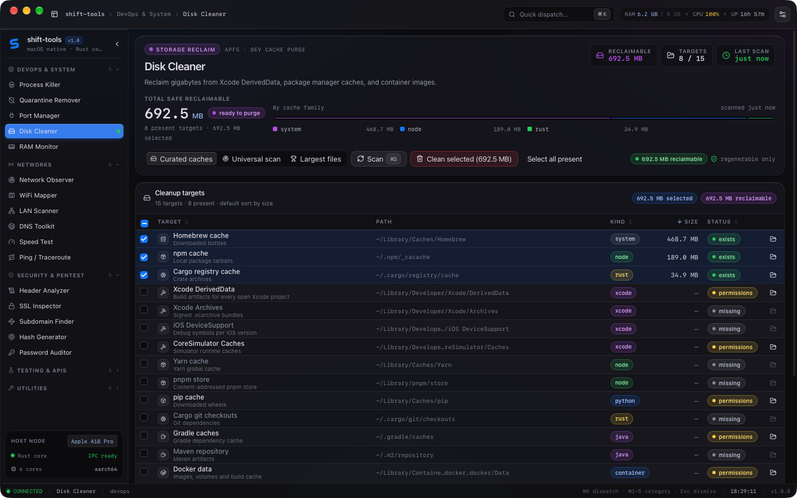
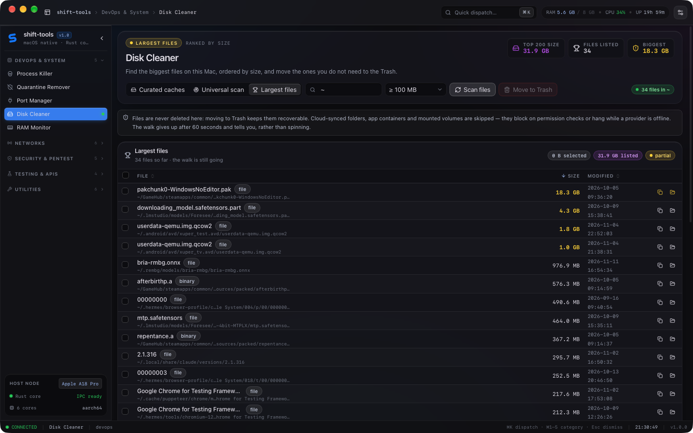
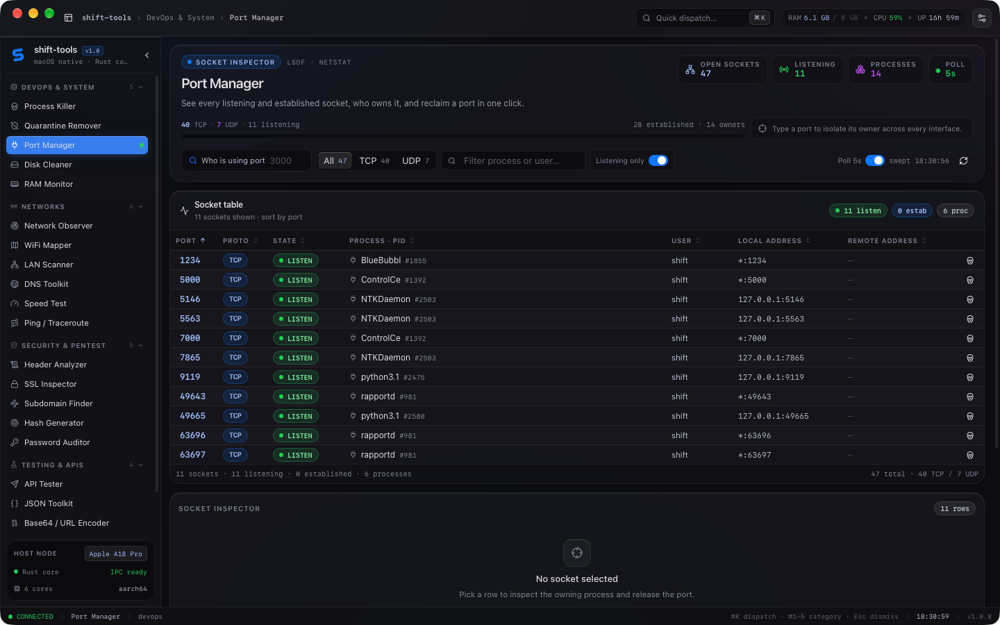

# shift-tools

<p align="center">
  <picture>
    <source media="(prefers-color-scheme: dark)" srcset="docs/brand/master/logo-horizontal.svg">
    
  </picture>
</p>

**A macOS Swiss army knife for developers, network engineers and testers.** 26 tools, one window,
a Rust core and a Tauri 2 shell. No Electron, no bundled Chromium, no telemetry.

[](https://github.com/fgvilches/shift-tools/actions/workflows/ci.yml)
[](https://github.com/fgvilches/shift-tools/releases)
[](LICENSE)


```
React 18 + TypeScript + Tailwind v4  ──IPC──▶  Rust (Tauri 2)  ──▶  macOS frameworks & CLIs
```

Every number on screen comes from the machine: `sysinfo`, `lsof`, CoreWLAN, CoreBluetooth, `rustls`,
`x509-parser`, real HTTP and DNS. There are no fixtures behind the UI, and when macOS does not expose
a value the view says so instead of inventing one.

## Install

Download the latest `.dmg` from [Releases](https://github.com/fgvilches/shift-tools/releases),
drag **shift-tools** into `/Applications`, and open it.

The build is not notarised yet, so the first launch needs **right-click → Open** (or
`System Settings → Privacy & Security → Open Anyway`). If you move the app from another Mac, clear
the quarantine bit — the app has a tool for exactly that.

### From source

```bash
npm install
npm run app          # tauri dev: Vite + native window with the real Rust backend
npm run app:build    # release .app + .dmg in src-tauri/target/release/bundle
```

Requires macOS 13+, Xcode Command Line Tools, Rust stable and Node 20+.

## Screenshots

| Process Killer — every process, dev ones split out | Disk Cleaner — universal cache sweep |
|---|---|
|  |  |

| Disk Cleaner — curated targets | Largest files, ranked |
|---|---|
|  |  |

| Port Manager — listening sockets and owners | |
|---|---|
|  | |

Captured from a real session on an Apple-silicon Mac; no mock data.

## What is inside

| Category | Tools |
|---|---|
| DevOps & System | Process Killer, Quarantine Remover, Port Manager, Disk Cleaner, RAM Monitor |
| Networks | Network Observer, WiFi Mapper, LAN Scanner, DNS Toolkit, Speed Test, Ping / Traceroute |
| Security & Pentest | Header Analyzer, SSL Inspector, Subdomain Finder, Hash Generator, Password Auditor |
| Testing & APIs | API Tester, JSON Toolkit, Base64 / URL Encoder, Regex Tester |
| Utilities | Color Picker, Text Diff, Timestamp Converter, Markdown Preview, Cron Validator, UUID Generator |

Keyboard: `⌘K` quick dispatch, `⌘1`–`⌘5` jump to the first tool of each category, `Esc` dismiss.

**Process Killer** lists every process and flags the dev ones, so the table is useful for the whole
machine, not just for a stale `node`. Sort by RAM, CPU, uptime, name or PID; kill one or all.
GPU usage is shown host-wide because macOS publishes no per-process GPU figure — the UI says that
rather than showing a column of zeros.

**Disk Cleaner** has three modes: curated caches, a universal sweep of every cache directory on the
Mac (user caches, app containers, dev stores, `/Library/Caches`), and a ranking of the largest files
on disk. Cleaning deletes the *contents* of cache directories only, behind a backend guard that
refuses anything outside your home or `/Library/Caches` and anything whose name is not cache-shaped.
Large files are **moved to the Trash**, never deleted.

## Permissions

macOS gates some of this data behind TCC. Each prompt is triggered by the action that needs it, and
the app explains the state on screen:

| Permission | Used by | Why |
|---|---|---|
| **Location Services** | Network Observer | CoreWLAN redacts SSIDs without it. No location is recorded or sent. |
| **Screen Recording** | Color Picker | Sampling a pixel needs it. |
| **Automation** | a few `osascript` helpers | Reading window and system state. |

Nothing leaves the machine: no analytics, no crash reporting, no update pings.

## Architecture

```
src/
  components/ui/        design-system kit (Button, DataTable, LogViewer, Charts, Modal, …)
  components/layout/    TitleBar, Sidebar, StatusBar, CommandPalette, ToolView shell
  lib/types.ts          domain types — mirrors the Rust structs 1:1 (camelCase on the wire)
  lib/api.ts            typed wrappers over Tauri `invoke`
  lib/ipc.ts            invoke wrapper, event subscription, error normalisation
  tools/registry.ts     tool catalogue, categories, lazy view loading, palette search
  tools/<tool>/         one folder per view
src-tauri/src/
  commands/system.rs    processes, ports, disks, quarantine, RAM, screen pixel
  commands/network.rs   Wi-Fi, Bluetooth, LAN, DNS, ping, traceroute, speed, subdomains, maps
  commands/security.rs  headers, TLS certificates, hashing, password strength/breach
  commands/testing.rs   HTTP client for the API Tester
  util.rs               process execution, fs helpers, HTTP client factory
docs/
  DESIGN.md             product spec and implementation plan
  BUILD-GUIDE.md        design system + data contract (the contract each view was built against)
  brand/                identity: concept studies, SVG masters, render pipeline
  mockups/<tool>/       hi-fi mockups (code.html + screen.png)
```

Rust commands are plain `#[tauri::command]` functions registered in `src-tauri/src/lib.rs`.
All structs use `#[serde(rename_all = "camelCase")]`, so the wire format matches TypeScript exactly.

## Implementation notes (honest status)

- **Process Killer / Port Manager** use `sysinfo` and `lsof`; SIGTERM then SIGKILL after a 3 s grace window. Critical PIDs and shift-tools itself are never signalled.
- **Network Observer (Wi-Fi)** reads the neighbour list through **CoreWLAN** (`CWInterface.scanForNetworks`), which is the only API macOS un-redacts, and falls back to `system_profiler SPAirPortDataType` when CoreWLAN yields nothing. `system_profiler` runs as a separate binary with its own TCC identity, so it keeps SSIDs redacted even after shift-tools is granted Location — that is why CoreWLAN is the primary source. The survey is cached because a scan costs several seconds. If permission is missing the view shows every SSID as hidden plus a **Grant Location access** button that asks CoreLocation on the main thread and a second button that deep-links straight to that pane. The usage strings live in `src-tauri/Info.plist`. Bluetooth lists the devices macOS reports (paired/connected), not raw BLE advertisements.
- **Vendor lookup** uses the full IEEE MA-L registry (40,439 assignments) embedded at build time from `src-tauri/src/data/oui.txt`; the LAN scanner shares it.
- **WiFi Mapper** persists maps as JSON files under `~/Library/Application Support/com.shift.tools/maps/`. The design doc specified SQLite; JSON was chosen for v1 so no migration layer is needed yet.
- **SSL Inspector** performs a real TLS handshake with `rustls` and parses the presented chain with `x509-parser`. The signature chain is *not* validated (it inspects, it does not trust), which is stated in the UI.
- **Color Picker** samples the screen through `screencapture`, so it needs Screen Recording permission.
- **Hash / Base64 / Regex / JSON / Cron / UUID / Timestamp** run locally in the WebView — no round trip needed for pure computation.

## Verification

```bash
npm run typecheck                                        # tsc --noEmit, strict
npm run build                                            # production bundle
cargo clippy --manifest-path src-tauri/Cargo.toml --all-targets -- -D warnings
cargo test --lib --manifest-path src-tauri/Cargo.toml    # live probes + guards
```

`tsc` and `clippy` must be clean and every view must render with live data from the Rust core — no
mock payloads. Views surface backend errors verbatim instead of pretending success.

The `live_tests` module performs real network calls (a TLS handshake against github.com, an HTTP
fetch of example.com, a DNS A lookup) so it needs connectivity; it is the only place where a network
failure is expected to fail the suite. The disk tests assert that the deletion guard refuses `~`,
`/etc` and `~/Documents` — a regression there would be destructive.

CI runs the typecheck and the frontend bundle on every push and pull request. The Rust job (tests +
clippy) and the release workflow need a macOS runner, which GitHub does not provide for private
repositories on the free plan — set the repository variable `ENABLE_MACOS_CI=true` to switch them on.
Releases build `.dmg` and `.zip` artifacts for Apple silicon and Intel on tag push.

## First run

Builds are **not code-signed with a Developer ID and not notarized** — there is no certificate in the build. The binary only carries the linker's ad-hoc signature, which is why macOS shows the "unidentified developer" warning when the app arrives from a download.

Until a Developer ID is set up, executing this code on terminal.app:

```bash
xattr -dr com.apple.quarantine /Applications/shift-tools.app
```


## License

MIT — see [LICENSE](LICENSE).
